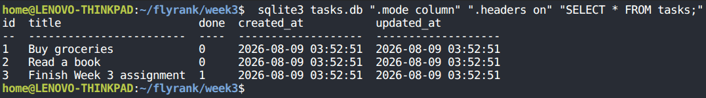

# FlyRank Week 3 - Assignment A2: Connecting CRUD to SQLite

A database-backed RESTful CRUD API built with Node.js, Express, and `better-sqlite3`. This project migrates the in-memory task storage from Assignment 1 to a persistent SQLite relational database.

---

## Quick Start

### 1. Install Dependencies
```bash
npm install
```

### 2. Start the Server
```bash
npm start
```
The server starts on `http://localhost:3000`. On first launch, `tasks.db` is created automatically, the `tasks` table schema is initialized, and three example tasks are seeded if the table is empty.

### 3. Run Automated Tests
```bash
npm test
```

---

## Tech Stack and Architecture

- **Language and Runtime:** JavaScript / Node.js
- **Web Framework:** Express.js
- **Database:** SQLite 3 (via `better-sqlite3` driver)
- **Persistence Layer:** `tasks.db` (created automatically on startup)
- **Testing:** `supertest` automated integration tests

---

## Why SQLite?

SQLite was selected for this backend service for four main reasons:

1. **Zero Configuration:** SQLite reads and writes directly to a single disk file (`tasks.db`). There is no separate database server daemon to install or manage.
2. **Persistence:** Data persists on disk across server restarts, ensuring state durability.
3. **Single File Database:** The database tables, indexes, and records reside inside `tasks.db`, which keeps development portable.
4. **Synchronous Execution:** The `better-sqlite3` driver operates synchronously, eliminating async boilerplate and keeping control flow explicit.

---

## Database Storage and Schema

The database file `tasks.db` lives in the project root directory. It is specified in `.gitignore` so each environment starts with a freshly initialized database.

### Schema (`tasks` table)

| Column | Type | Constraints | Description |
|---|---|---|---|
| `id` | INTEGER | PRIMARY KEY AUTOINCREMENT | Unique task identifier generated by SQLite |
| `title` | TEXT | NOT NULL | Task description |
| `done` | INTEGER | NOT NULL DEFAULT 0 | Completion status (0 for false, 1 for true) |
| `created_at` | DATETIME | DEFAULT CURRENT_TIMESTAMP | Timestamp when the task was created |
| `updated_at` | DATETIME | DEFAULT CURRENT_TIMESTAMP | Timestamp when the task was last updated |

---

## Native SQLite CLI Verification

Below is a terminal view inspecting `tasks.db` using the default native `sqlite3` command line tool:

```bash
sqlite3 tasks.db ".mode column" ".headers on" "SELECT * FROM tasks;"
```

```text
id  title                     done  created_at           updated_at         
--  ------------------------  ----  -------------------  -------------------
1   Buy groceries             0     2026-08-09 03:52:51  2026-08-09 03:52:51
2   Read a book               0     2026-08-09 03:52:51  2026-08-09 03:52:51
3   Finish Week 3 assignment  1     2026-08-09 03:52:51  2026-08-09 03:52:51
```



---

## Stage 4: Direct SQL Exploration

In Stage 4, SQL queries were run directly against `tasks.db` via the SQLite CLI to inspect state independently of the HTTP server.

### Example Query 1: Count total tasks
```sql
SELECT COUNT(*) FROM tasks;
```
**Output:** `3`

### Example Query 2: Filter completed tasks
```sql
SELECT * FROM tasks WHERE done = 1;
```
**Output:**
```text
3|Finish Week 3 assignment|1|2026-08-09 03:52:51|2026-08-09 03:52:51
```

### Example Query 3: Update task state directly on disk
```sql
UPDATE tasks SET done = 1 WHERE id = 1;
```
Calling `GET http://localhost:3000/tasks/1` returned `"done": true` immediately without a server restart, demonstrating that the database file is the single source of truth.

---

## API Endpoints Reference

| Method | Endpoint | Description | Success Code | Error Code |
|---|---|---|---|---|
| `GET` | `/tasks` | List all tasks (supports `?search=`, `?done=`, `?sort=`) | `200 OK` | - |
| `GET` | `/tasks/:id` | Fetch a single task by ID | `200 OK` | `404 Not Found` / `400 Bad Request` |
| `POST` | `/tasks` | Create a new task (`{ "title": "string" }`) | `201 Created` | `400 Bad Request` |
| `PUT` | `/tasks/:id` | Update task title or completion status | `200 OK` | `404 Not Found` / `400 Bad Request` |
| `DELETE` | `/tasks/:id` | Delete a task by ID | `204 No Content` | `404 Not Found` / `400 Bad Request` |
| `GET` | `/stats` | Return SQL-calculated task metrics | `200 OK` | - |

---

## Parameterized Queries and Security

All SQL queries strictly use parameterized placeholders (`?`) provided by `better-sqlite3`. User inputs are passed as parameters and are never concatenated directly into SQL query strings. This prevents SQL injection vulnerabilities.

Example:
```js
const stmt = db.prepare('SELECT * FROM tasks WHERE id = ?');
const row = stmt.get(id);
```

---

## Storage as an Implementation Detail

The HTTP API contracts, URL endpoints, request payload structures, error responses, and HTTP status codes (`200`, `201`, `204`, `400`, `404`) remain identical to Assignment 1.

Because HTTP client tests interact exclusively with the public API interface, replacing the in-memory array with SQLite disk storage required no changes to client code or API test assertions. This demonstrates that storage is an implementation detail encapsulated behind the API boundary.

---

## Stretch Goals and Enhancements

1. **SQL Search (`LIKE`):** `GET /tasks?search=groceries` filters titles at the database layer.
2. **SQL Filtering:** `GET /tasks?done=true` filters tasks using `WHERE done = ?`.
3. **SQL Sorting:** `GET /tasks?sort=asc` or `sort=desc` orders records with `ORDER BY title`.
4. **Database Transactions:** Initial task seeding is wrapped in `db.transaction()` for atomic execution.
5. **Database Indexing:** SQLite indexes accelerate lookups. An index on `done` (`CREATE INDEX IF NOT EXISTS idx_tasks_done ON tasks(done);`) allows fast filtering without full table scans.
